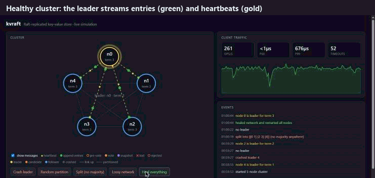

# kvraft

[](https://github.com/zeiado/kvraft/actions/workflows/ci.yml)


A fault-tolerant, **linearizable** key-value store built from scratch on the Raft consensus algorithm, in Go.

Kill the leader, cut the network in half, or pull the power on every node at once. The cluster elects a new leader, keeps serving, and never returns a stale or lost write. Every one of those claims is checked automatically: a chaos tester injects faults while clients hammer the store, then proves the recorded history is linearizable.



*The live visualizer (`go run ./cmd/kvsim`). Every dot is a real Raft message: heartbeats, log entries, pre-votes, votes and snapshots. A red ✕ is a message lost to a crash or partition.*

## Highlights

- **Raft from the paper up.** Leader election, log replication, persistence, snapshots and InstallSnapshot, plus the extensions real systems need: **Pre-Vote**, **check-quorum**, **ReadIndex** linearizable reads, and fast log backtracking.
- **Crash-safe storage.** A segmented write-ahead log with CRC32-C framing, torn-write recovery and **group commit**: fsync runs outside the Raft lock, so many writes share one fsync and a slow disk never stalls heartbeats.
- **Exactly-once writes.** Clients tag requests with `(clientID, seq)`, so a retried `put` or `cas` never applies twice, even across leader changes.
- **Verified with a linearizability checker.** Randomized fault injection (crashes, partitions, message loss, delay, full power outages) with every history checked by [porcupine](https://github.com/anishathalye/porcupine). The tests also prove the checker catches deliberately broken builds.
- **Live visualizer.** Watch every Raft message fly between nodes, then crash nodes and split the network from your browser.
- **Zero runtime dependencies.** The standard library only; porcupine is used by the tests.

## Try it in 30 seconds

```bash
git clone https://github.com/zeiado/kvraft && cd kvraft

# 1. The visualizer: a 5-node cluster in one process. Open http://localhost:8080
go run ./cmd/kvsim

# 2. A real 5-node cluster in Docker
docker compose -f deploy/docker-compose.yml up -d --build
go run ./cmd/kvctl put greeting hello
go run ./cmd/kvctl get greeting
go run ./cmd/kvctl status
docker compose -f deploy/docker-compose.yml kill node0   # crash a node, try again

# 3. Chaos: 20 randomized fault-injection runs, each checked for linearizability
go run ./cmd/kvchaos -runs 20
```

## How it's verified

`kvchaos` (and `go test ./chaos`) runs a cluster while concurrent clients issue `get`, `put`, `delete` and `cas` on a small set of keys, so they contend. Meanwhile, a nemesis injects faults:

| Fault | What it does |
|---|---|
| crash / crash-leader | Kill a node; it restarts later from its own storage |
| **power outage** | Kill *every* node at once; writes not yet fsynced are lost |
| partition / isolate-leader | Split the network into groups that can't talk |
| lossy network | Drop 10% of messages, delay the rest up to 25ms |

Each operation's start and end times are recorded, and porcupine checks that the history is **linearizable**: there must be one order of operations, consistent with real time, that explains every result.

The suite also proves the checker isn't asleep:

```
$ go run ./cmd/kvchaos -runs 4 -unsafe-reads      # serve reads from any replica, no ReadIndex
run 1 ... NOT LINEARIZABLE -> kvchaos-<seed>.html  # porcupine's visual counterexample
...
4 runs: 0 linearizable, 4 violations
```

During development the same harness caught a real durability bug class. When followers acknowledged entries before fsyncing them, the power-outage fault produced violations in **10 of 12 runs**. With the correct code, every run passes. See [docs/TESTING.md](docs/TESTING.md).

## Performance

5-node cluster in Docker Desktop (WSL2) on a laptop, fsync on, 50/50 reads and writes on 1,000 keys:

| Clients | Throughput | p50 | p99 |
|---:|---:|---:|---:|
| 1 | 209 ops/s | 3.5 ms | 18 ms |
| 16 | 724 ops/s | 20 ms | 61 ms |
| 64 | 2,673 ops/s | 24 ms | 53 ms |

Throughput scales with clients because of group commit: concurrent writes share fsyncs. Across 40,000 writes and four snapshots the cluster stayed on one leader (term 1).

**Failover:** killing the leader container mid-benchmark (16 clients) caused one election. The worst request took 398 ms, with **0 failed requests**, and the restarted node caught up automatically.

Reproduce with `kvctl bench -clients 64 -duration 10s`. Numbers are from one machine; treat them as a shape, not a spec.

## Architecture

```
               client (kvctl / kv.Client)
                  │  POST /kv   retries + leader hints, exactly-once seq numbers
                  ▼
 ┌─────────────────────────────── node ───────────────────────────────┐
 │  kv.Server     state machine: map + dedup table, snapshots         │
 │     │ Start(cmd)          ▲ ApplyMsg (committed entries, snapshots) │
 │     ▼                     │                                         │
 │  raft.Raft     election · replication · commit · ReadIndex          │
 │     │  Storage                          │  Transport                │
 │     ▼                                   ▼                           │
 │  storage.FileStorage                 httpnet (JSON over HTTP)       │
 │  segmented WAL + snapshot.bin        memnet (in-process, faults)    │
 └─────────────────────────────────────────────────────────────────────┘
```

| Package | What's in it |
|---|---|
| [`raft`](raft) | The consensus algorithm, independent of network and disk |
| [`storage`](storage) | Segmented WAL with CRC framing, group commit, atomic snapshots |
| [`kv`](kv) | Linearizable KV state machine, client with retries and dedup |
| [`transport/httpnet`](transport/httpnet) | Raft RPCs and the client API over HTTP |
| [`transport/memnet`](transport/memnet) | In-process network that can partition, drop and delay |
| [`sim`](sim) | Whole cluster in one process, with crash and partition controls |
| [`chaos`](chaos) | Fault injection plus linearizability checking |
| [`cmd/*`](cmd) | `kvserver`, `kvctl`, `kvsim` (visualizer), `kvchaos` |

The design decisions, including why reads don't go through the log, how group commit stays safe, and what Pre-Vote fixes, are in [docs/DESIGN.md](docs/DESIGN.md).

## API

```bash
curl -X POST localhost:8001/kv -d '{"type":"put","key":"a","value":"1"}'
curl -X POST localhost:8001/kv -d '{"type":"get","key":"a"}'
curl -X POST localhost:8001/kv -d '{"type":"cas","key":"a","expected":"1","value":"2"}'
curl localhost:8001/status
```

A non-leader answers `{"error":"kv: not the leader","leader":3}`. `kv.Client` and `kvctl` follow the hint automatically.

## Limitations

- Cluster membership is fixed at startup; there's no joint consensus.
- Reads use ReadIndex (one heartbeat round per read), not leases, and they aren't batched yet.
- JSON over HTTP is easy to debug but not the fastest wire format.
- Snapshots hold the whole state machine in memory.

## License

MIT
